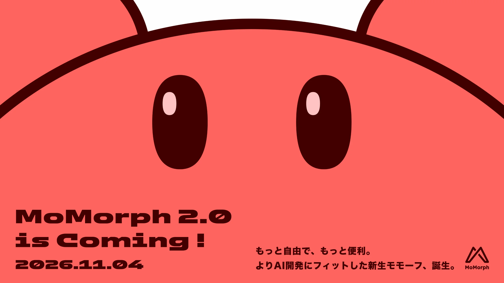
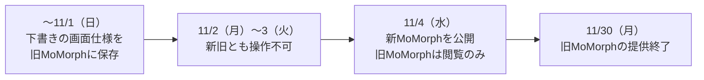
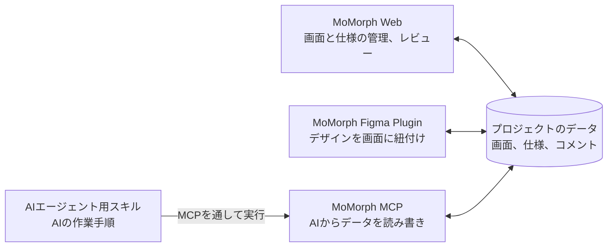
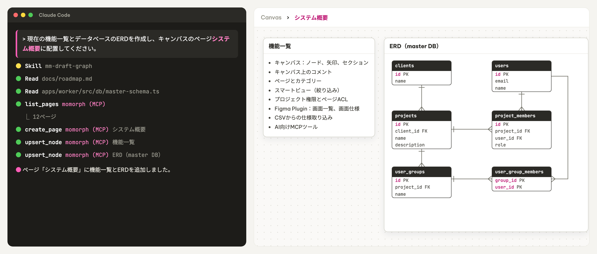
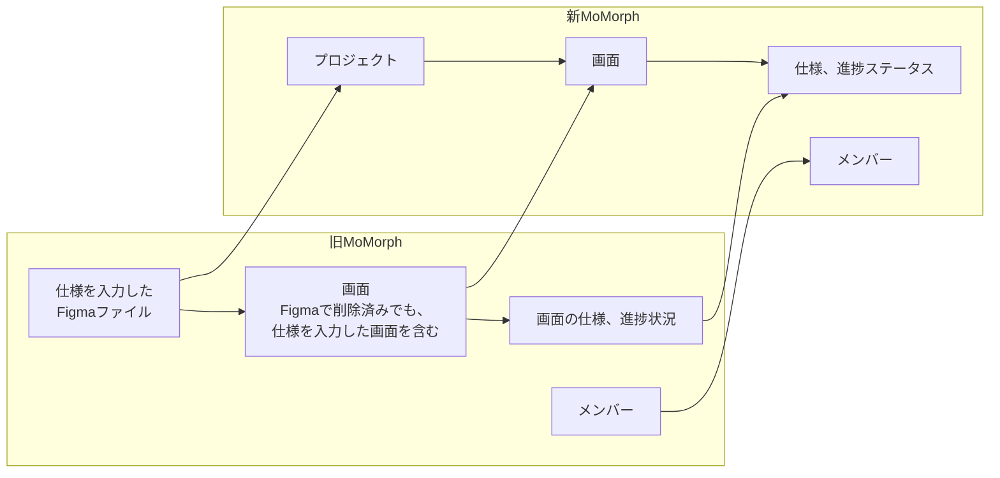
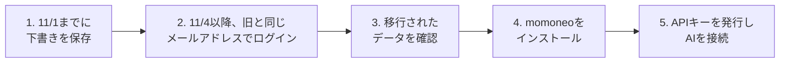
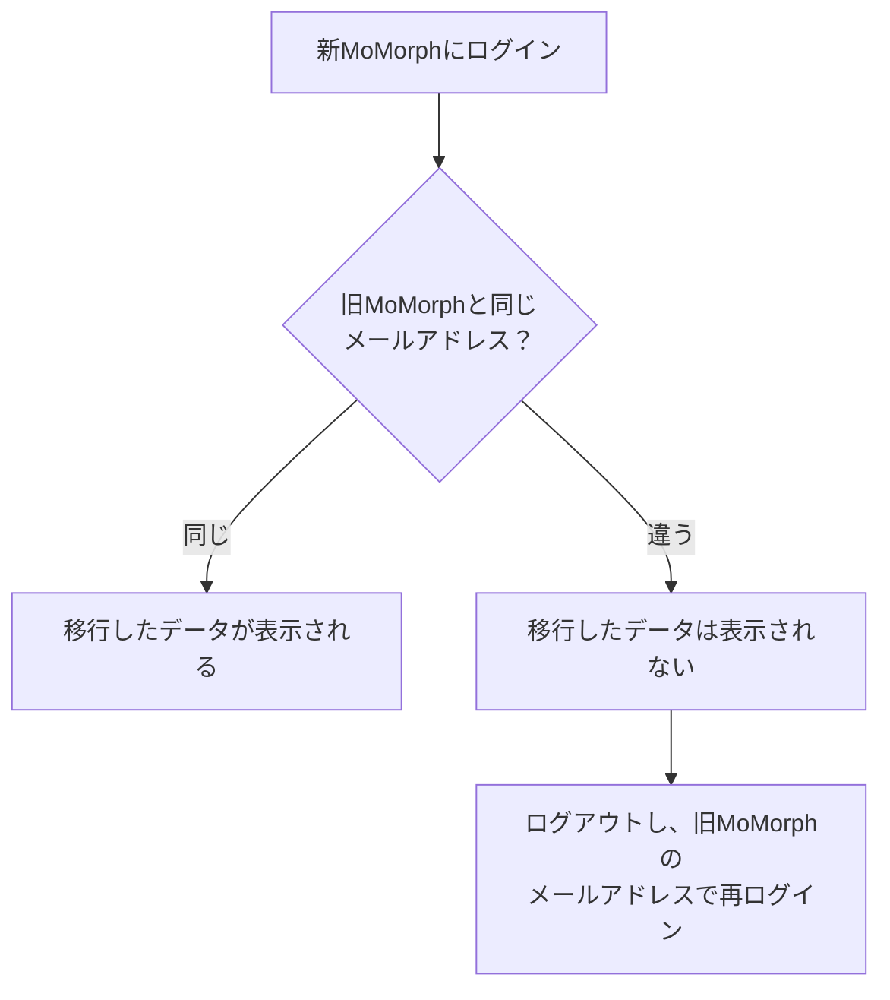
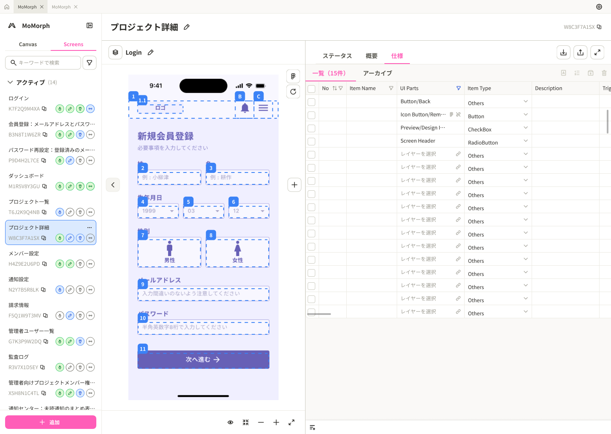

# V1からV2への移行

新MoMorph（V2）は、2026年11月4日に公開します。旧MoMorph（V1）は、11月30日に提供を終了します。このページでは、旧MoMorphから変わる点、移行されるデータ、利用中の方へのお願いを説明します。

## 1. 移行スケジュール {#schedule}

| 日付 | 内容 | 利用者の対応 |
|---|---|---|
| 〜11/1（日） | 旧MoMorphで作業できる最終日 | 下書きの画面仕様を、旧MoMorphに**保存**する |
| 11/2（月）〜3（火） | データの移行 | **新旧とも操作できない** |
| 11/4（水） | 新MoMorphを公開。旧MoMorphは閲覧のみ | 新MoMorphにログインし、データを確認する |
| 11/30（月） | 旧MoMorphの提供終了 | 必要な情報を、この日までに確認する |

!!! warning "11/1（日）までに保存してください"
    保存していない下書きの画面仕様は、新MoMorphに移行されません。

## 2. 新MoMorphの製品 {#products}

4つの製品が、同じプロジェクトのデータを共有します。

各製品の使い方：[MoMorph V2の使い方](v2-user-guide.md)

## 3. 旧MoMorphから変わる主な点 {#changes}

| 変わる点 | 旧MoMorph | 新MoMorph |
|---|---|---|
| ログイン | Figmaのアカウント | GoogleまたはGitHubのアカウント。WebとFigma Pluginに同じアカウントでログイン |
| 使える人 | プラン（Essential、Pro）による | 管理者の招待、または参加申請の承認 |
| AIでの仕様作成 | 製品内の生成ボタン | 生成ボタンを廃止。Claude CodeなどのAIから依頼 |
| 議論とレビュー | 画面へのコメント | キャンバスのコメントと承認スタンプ |
| 画面タグ | タグで絞り込み | 廃止。ステータスとFigmaページで絞り込む |
| エクスポート | 複数の形式 | CSVに一本化 |
| Web | `momorph.ai` | [app.momorph.ai](https://app.momorph.ai) |
| Figma Plugin | プラグイン「MoMorph」 | プラグイン「momoneo」 |

## 4. 新MoMorphで新しくできること {#new-features}

| 機能 | できること |
|---|---|
| GoogleまたはGitHubでログイン | WebとFigma Pluginに、同じアカウントでログインする |
| 全員で同時に編集 | 同じキャンバスを、複数人で同時に編集する |
| 仕様、図、画面を1枚に | 仕様、図、画面キャプチャを並べて確認する |
| 承認ワークフロー | 承認の手順を設定する。誰がいつ承認したかが記録される |
| GitHubと連携 | GitHub上のドキュメントをキャンバスに表示し、元のファイルとの差異を確認する |
| CSVを直接取り込み | CSVファイルを、プラグインとWebの仕様表に直接取り込む |

## 5. 移行されるデータ {#migrated-data}

主な仕様データは、新MoMorphに引き継がれます。

| 移行される | 移行されない |
|---|---|
| 仕様を入力したFigmaファイル | 仕様のないFigmaファイル |
| そのファイルの画面、画面の仕様、進捗状況、メンバー | 削除、アーカイブした画面 |
| Figmaで削除済みでも、仕様を入力した画面 | プレビュー画像 |

### 移行されないデータの扱い {#not-migrated}

| 区分 | データ | 扱い |
|---|---|---|
| プレビュー画像 | 画面のプレビュー画像 | MoMorph Figma Pluginを開くと再保存される |
| 未開発の機能 | 仕様の履歴、スプレッドシート出力、GitHub課題登録 | 12月に開発を予定 |
| 提供を終える機能 | 画面の翻訳、画面へのコメント、画面のグループ、画面のテストケース、登録したプロンプト、アップロードした辞書、操作履歴、画面タグ | 移行しない |

## 6. 利用者が行う作業 {#user-steps}

### 6.1 旧MoMorphと同じメールアドレスでログインする {#login-same-email}

旧MoMorphと**同じメールアドレス**でログインすると、移行したデータが表示されます。

手順：[1.1 Webにログイン](v2-user-guide.md#login-web)

### 6.2 移行されたデータを確認する {#check-data}

1. [app.momorph.ai](https://app.momorph.ai)を開きます。
2. ホーム画面で、旧MoMorphのFigmaファイルにあたるプロジェクトを開きます。
3. 画面一覧、画面の仕様、進捗ステータスを確認します。

### 6.3 Figma Plugin「momoneo」をインストールする {#install-plugin}

旧MoMorphのプラグインは、新MoMorphに接続できません。[1.7 Figma Pluginにログイン](v2-user-guide.md#login-plugin)の手順で、「momoneo」をインストールします。プラグインを開くと、プレビュー画像が再保存されます。

### 6.4 AIを接続する {#connect-ai}

旧MoMorphのMCP設定は、新MoMorphでは使えません。

1. [1.5 APIキーの発行](v2-user-guide.md#api-key)の手順で、**「読み取り・編集」**の権限のAPIキーを発行します。
2. [1.6 MCPでAIと接続](v2-user-guide.md#connect-ai)の手順で、Claude DesktopまたはClaude Codeを接続します。

## 7. 旧MoMorphのドキュメント {#v1-docs}

旧MoMorphのドキュメントは、**アーカイブ（V1）**にあります。

- [V1 総合ユーザーガイド](archived/general-user-guide.md)
- [V1 MCPツールリファレンス](archived/mcp-tools-reference.md)
- [V1 よくある質問](archived/faq.md)
- [V1 リリースノート](archived/release-notes.md)

## 8. お問い合わせ {#contact}

Slackの`#con_momorph-support_all`にあるフォームから送信してください。
