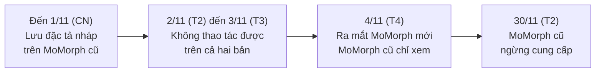
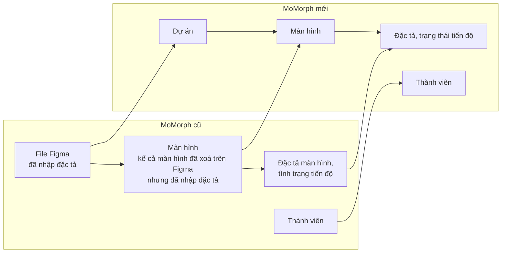
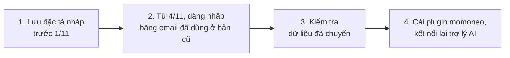
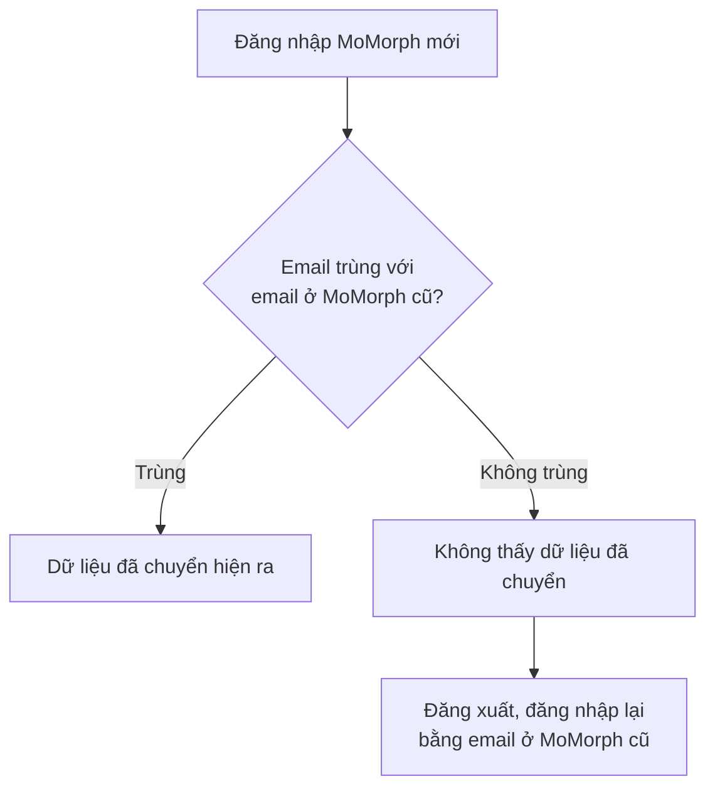

# Hướng dẫn chuyển từ V1 sang V2

MoMorph mới (V2) ra mắt ngày 4/11/2026. MoMorph cũ (V1) ngừng cung cấp ngày 30/11/2026. Trang này nêu những điểm thay đổi so với MoMorph cũ, dữ liệu được chuyển, và việc người đang dùng MoMorph cũ phải làm. Cách dùng MoMorph mới xem tại [Hướng dẫn sử dụng MoMorph V2](v2-user-guide.md).

## 1. Lịch chuyển đổi {#schedule}

| Ngày | Nội dung | Việc người dùng phải làm |
|---|---|---|
| Đến 1/11 (CN) | Ngày cuối làm việc trên MoMorph cũ | **Lưu** đặc tả màn hình đang nháp trên MoMorph cũ |
| 2/11 (T2) đến 3/11 (T3) | Chuyển dữ liệu | **Không thao tác được trên cả hai bản** |
| 4/11 (T4) | Ra mắt MoMorph mới. MoMorph cũ chỉ xem | Đăng nhập MoMorph mới, kiểm tra dữ liệu |
| 30/11 (T2) | MoMorph cũ ngừng cung cấp | Xem lại thông tin cần thiết trước ngày này |

!!! warning "Lưu trước 1/11 (CN)"
    Đặc tả màn hình đang nháp mà chưa lưu sẽ không được chuyển sang MoMorph mới.

## 2. Điểm thay đổi chính so với MoMorph cũ {#changes}

| Hạng mục | MoMorph cũ | MoMorph mới |
|---|---|---|
| Đăng nhập | Tài khoản Figma | Tài khoản Google hoặc GitHub |
| Ai dùng được | Theo gói Essential hoặc Pro | Được quản trị viên mời, hoặc yêu cầu tham gia được duyệt |
| Tạo đặc tả bằng AI | Nút tạo bằng AI trong sản phẩm | Bỏ nút này. Nhờ trợ lý AI như Claude Code |
| Thảo luận và rà soát | Bình luận trên màn hình | Bình luận và tem duyệt trên bảng làm việc |
| Nhãn màn hình | Lọc theo nhãn | Bỏ nhãn. Lọc theo trạng thái và trang Figma |
| Xuất file | Nhiều định dạng | Chỉ CSV |
| Web | `momorph.ai` | `app.momorph.ai` |

## 3. Dữ liệu được chuyển {#migrated-data}

Dữ liệu đặc tả chính được chuyển sang MoMorph mới.

| Được chuyển | Không được chuyển |
|---|---|
| File Figma đã nhập đặc tả | File Figma chưa có đặc tả |
| Màn hình, đặc tả màn hình, tình trạng tiến độ, thành viên của file đó | Màn hình đã xoá hoặc đã lưu trữ |
| Màn hình đã xoá trên Figma nhưng đã nhập đặc tả | Ảnh xem trước |

### Dữ liệu không được chuyển {#not-migrated}

| Nhóm | Dữ liệu | Cách xử lý |
|---|---|---|
| Ảnh xem trước | Ảnh xem trước của màn hình | Ảnh được lưu lại khi mở MoMorph Figma Plugin |
| Tính năng chưa phát triển | Lịch sử đặc tả, xuất ra bảng tính, đăng ký GitHub Issue | Dự kiến phát triển trong tháng 12 |
| Tính năng ngừng cung cấp | Dịch màn hình, bình luận trên màn hình, nhóm màn hình, ca kiểm thử của màn hình, câu lệnh AI đã đăng ký, từ điển đã tải lên, lịch sử thao tác, nhãn màn hình | Không chuyển |

## 4. Việc người dùng phải làm {#user-steps}

### 4.1 Đăng nhập bằng đúng email đã dùng ở MoMorph cũ {#login-same-email}

Dữ liệu đã chuyển chỉ hiện ra khi đăng nhập bằng **đúng email** đã dùng ở MoMorph cũ.

### 4.2 Kiểm tra dữ liệu đã chuyển {#check-data}

1. Ở **"Danh sách project"**, mở dự án ứng với file Figma ở MoMorph cũ.
2. Kiểm tra danh sách màn hình, đặc tả màn hình và trạng thái tiến độ.

### 4.3 Cài lại plugin và kết nối lại trợ lý AI {#reconnect}

Plugin và cấu hình MCP của MoMorph cũ không dùng được cho MoMorph mới. Cài đặt lại theo các bước sau:

- Plugin "momoneo": [1.7 Đăng nhập Figma Plugin](v2-user-guide.md#login-plugin)
- API key và kết nối trợ lý AI: [1.5 Tạo API key](v2-user-guide.md#api-key), [1.6 Kết nối trợ lý AI qua MCP](v2-user-guide.md#connect-ai)

## 5. Tài liệu MoMorph cũ {#v1-docs}

Tài liệu MoMorph cũ được giữ ở mục **Lưu trữ (V1)**:

- [Hướng dẫn sử dụng V1](archived/general-user-guide.md)
- [Chi tiết công cụ MCP Server V1](archived/mcp-tools-reference.md)
- [Câu hỏi thường gặp V1](archived/faq.md)
- [Ghi chú phát hành V1](archived/release-notes.md)

## 6. Liên hệ {#contact}

Gửi qua biểu mẫu trong kênh Slack `#con_momorph-support_all`.
