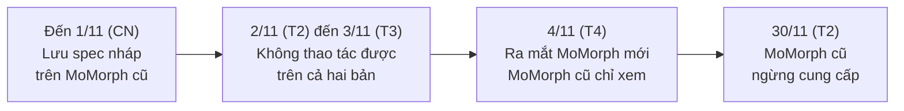
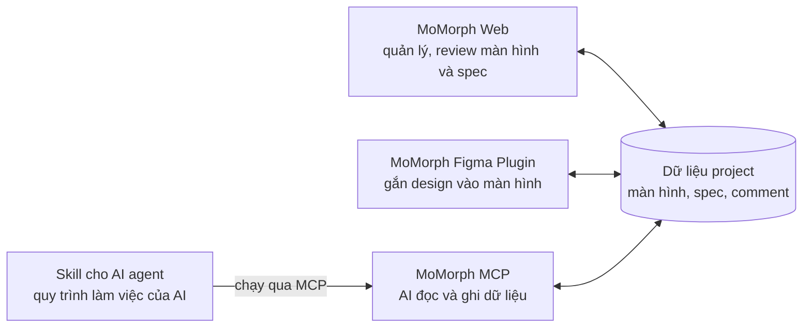
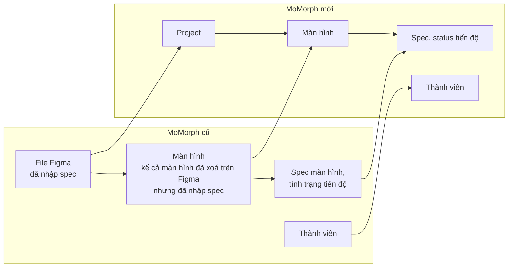
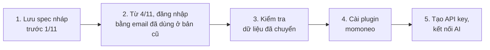
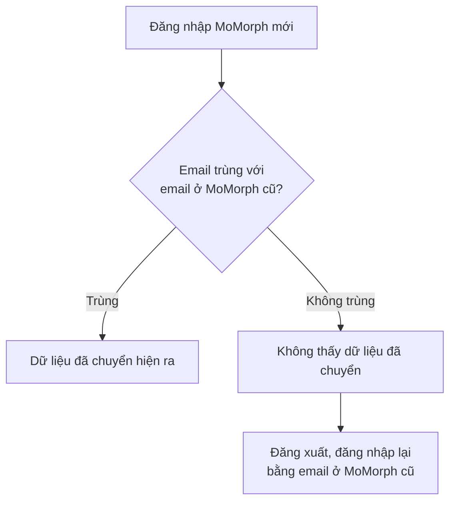

# Hướng dẫn chuyển từ V1 sang V2

MoMorph mới (V2) ra mắt ngày 4/11/2026. MoMorph cũ (V1) ngừng cung cấp ngày 30/11/2026. Trang này nêu những điểm thay đổi so với MoMorph cũ, dữ liệu được chuyển, và việc người đang dùng MoMorph cũ phải làm.

## 1. Lịch chuyển đổi {#schedule}

| Ngày | Nội dung | Việc người dùng phải làm |
|---|---|---|
| Đến 1/11 (CN) | Ngày cuối làm việc trên MoMorph cũ | **Lưu** spec màn hình đang nháp trên MoMorph cũ |
| 2/11 (T2) đến 3/11 (T3) | Chuyển dữ liệu | **Không thao tác được trên cả hai bản** |
| 4/11 (T4) | Ra mắt MoMorph mới. MoMorph cũ chỉ xem | Đăng nhập MoMorph mới, kiểm tra dữ liệu |
| 30/11 (T2) | MoMorph cũ ngừng cung cấp | Xem lại thông tin cần thiết trước ngày này |

!!! warning "Lưu trước 1/11 (CN)"
    Spec màn hình nháp chưa lưu sẽ không được chuyển sang MoMorph mới.

## 2. Các sản phẩm của MoMorph mới {#products}

4 sản phẩm dùng chung dữ liệu của một project.

Cách dùng từng sản phẩm: [Hướng dẫn sử dụng MoMorph V2](v2-user-guide.md)

## 3. Điểm thay đổi chính so với MoMorph cũ {#changes}

| Hạng mục | MoMorph cũ | MoMorph mới |
|---|---|---|
| Đăng nhập | Tài khoản Figma | Tài khoản Google hoặc GitHub. Web và Figma Plugin dùng cùng một tài khoản |
| Ai dùng được | Theo plan Essential hoặc Pro | Được admin mời, hoặc yêu cầu tham gia được duyệt |
| Tạo spec bằng AI | Nút generate trong sản phẩm | Bỏ nút generate. Nhờ AI như Claude Code |
| Thảo luận và review | Comment trên màn hình | Comment và stamp approve trên canvas |
| Tag màn hình | Lọc theo tag | Bỏ tag. Lọc theo status và page Figma |
| Export | Nhiều định dạng | Chỉ CSV |
| Web | `momorph.ai` | [app.momorph.ai](https://app.momorph.ai) |
| Figma Plugin | Plugin「MoMorph」 | Plugin「momoneo」 |

## 4. Tính năng mới {#new-features}

| Tính năng | Làm được gì |
|---|---|
| Đăng nhập bằng Google hoặc GitHub | Đăng nhập Web và Figma Plugin bằng cùng một tài khoản |
| Cùng sửa một lúc | Nhiều người sửa cùng một canvas cùng lúc |
| Spec, sơ đồ, màn hình trên một trang | Đặt spec, sơ đồ, ảnh chụp màn hình cạnh nhau để xem |
| Workflow approve | Cài các bước approve. Hệ thống ghi lại ai approve lúc nào |
| Liên kết GitHub | Hiện tài liệu trên GitHub lên canvas, xem khác biệt so với file gốc |
| Import CSV trực tiếp | Import file CSV thẳng vào bảng spec trên Plugin và Web |

## 5. Dữ liệu được chuyển {#migrated-data}

Dữ liệu spec chính được chuyển sang MoMorph mới.

| Được chuyển | Không được chuyển |
|---|---|
| File Figma đã nhập spec | File Figma chưa có spec |
| Màn hình, spec màn hình, tình trạng tiến độ, thành viên của file đó | Màn hình đã xoá hoặc archive |
| Màn hình đã xoá trên Figma nhưng đã nhập spec | Ảnh preview |

### Dữ liệu không được chuyển {#not-migrated}

| Nhóm | Dữ liệu | Cách xử lý |
|---|---|---|
| Ảnh preview | Ảnh preview của màn hình | Mở MoMorph Figma Plugin, ảnh được lưu lại |
| Tính năng chưa phát triển | Lịch sử spec, xuất spreadsheet, tạo issue GitHub | Dự kiến phát triển trong tháng 12 |
| Tính năng ngừng cung cấp | Dịch màn hình, comment trên màn hình, nhóm màn hình, test case của màn hình, prompt đã đăng ký, từ điển đã upload, lịch sử thao tác, tag màn hình | Không chuyển |

## 6. Việc người dùng phải làm {#user-steps}

### 6.1 Đăng nhập bằng đúng email đã dùng ở MoMorph cũ {#login-same-email}

Đăng nhập bằng **cùng email** đã dùng ở MoMorph cũ thì dữ liệu đã chuyển mới hiện ra.

Các bước: [1.1 Đăng nhập Web](v2-user-guide.md#login-web)

### 6.2 Kiểm tra dữ liệu đã chuyển {#check-data}

1. Mở [app.momorph.ai](https://app.momorph.ai).
2. Ở trang Home, mở project ứng với file Figma ở MoMorph cũ.
3. Kiểm tra danh sách màn hình, spec màn hình và status tiến độ.

### 6.3 Cài Figma Plugin「momoneo」 {#install-plugin}

Plugin của MoMorph cũ không kết nối được với MoMorph mới. Cài「momoneo」theo [1.7 Đăng nhập Figma Plugin](v2-user-guide.md#login-plugin). Khi mở plugin, ảnh preview được lưu lại.

### 6.4 Kết nối AI {#connect-ai}

Cấu hình MCP của MoMorph cũ không dùng được cho MoMorph mới.

1. Tạo API key quyền `write` theo [1.5 Tạo API key](v2-user-guide.md#api-key).
2. Kết nối Claude Desktop hoặc Claude Code theo [1.6 Kết nối AI qua MCP](v2-user-guide.md#connect-ai).

## 7. Tài liệu MoMorph cũ {#v1-docs}

Tài liệu MoMorph cũ được giữ ở mục **Lưu trữ (V1)**:

- [Hướng dẫn sử dụng V1](archived/general-user-guide.md)
- [Chi tiết công cụ MCP Server V1](archived/mcp-tools-reference.md)
- [Câu hỏi thường gặp V1](archived/faq.md)
- [Release Notes V1](archived/release-notes.md)

## 8. Liên hệ {#contact}

Gửi qua form trong kênh Slack `#con_momorph-support_all`.
