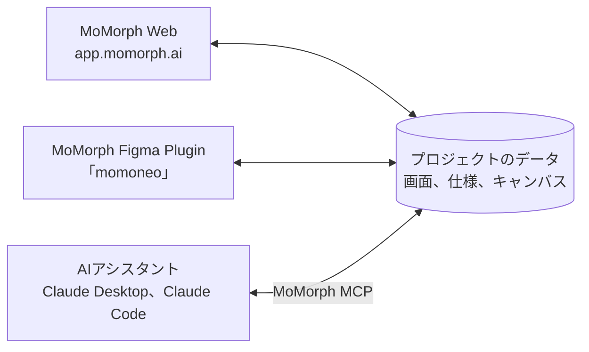
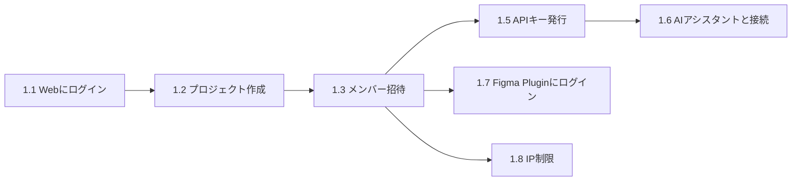
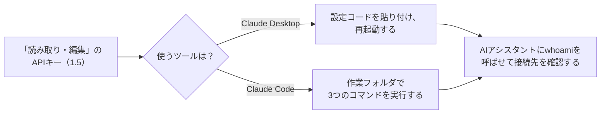
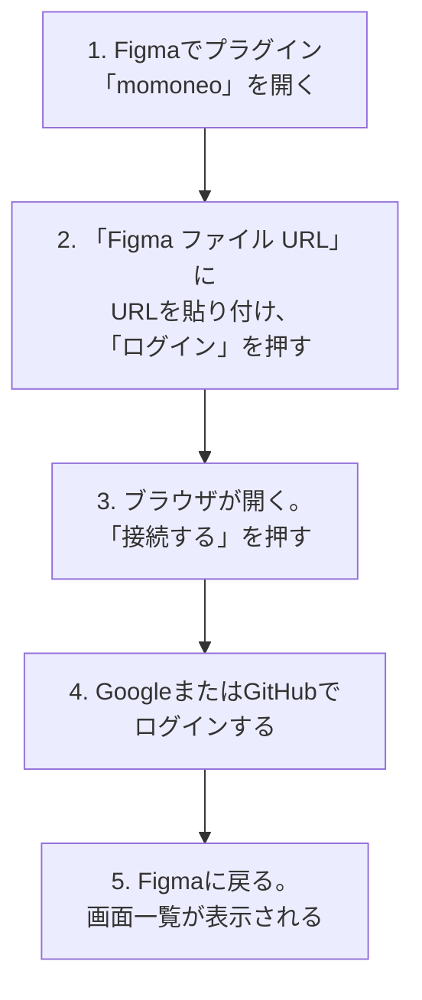
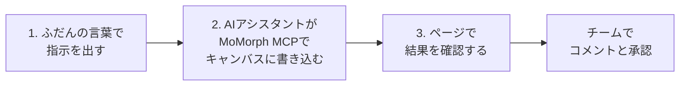
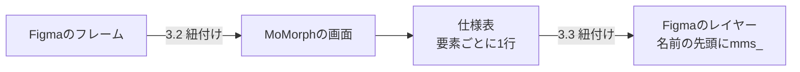
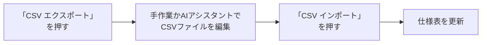

# MoMorph V2の使い方

MoMorph V2は、プロジェクトのメンバーが仕様やアイデアを1か所で一緒に管理し、レビューするためのツールです。MoMorph Web、MoMorph Figma Plugin、AIは同じプロジェクトのデータを使います。どこで書いた内容も、すぐにほかの場所で確認できます。



## 目次

1. [セットアップ](#setup)
2. [MCPとWeb Canvasの使い方](#mcp-canvas)
3. [Figma Pluginの画面と画面仕様](#plugin)
4. [MoMorph Webの画面と画面仕様](#web-screens)
5. [リンク](#links)

---

## 1. セットアップ {#setup}



1.1から1.3は必須です。1.4から1.8は、必要な場合だけ行います。

### 1.1 Webにログイン {#login-web}

1. [app.momorph.ai](https://app.momorph.ai)を開きます。
2. **「Googleアカウントでログイン」**または**「GitHubアカウントでログイン」**を押します。

{ width="720" }

3. 初回ログイン時は、5つの手順の使い方ガイドが表示されます。**「?」**ボタン（**「使い方ガイドを表示」**）を押すと、ガイドを再表示できます。

{ width="720" }

### 1.2 プロジェクト作成 {#create-project}

プロジェクトは、画面、仕様、キャンバスをまとめて管理する単位です。

1. **「プロジェクト一覧」**で、**「＋ 新しいプロジェクトを作成」**を押します。
2. プロジェクト名を入力し、**「作成」**を押します。
3. 作成したプロジェクトは、一覧にカードで表示されます。カードを押すと開きます。

{ width="720" }

!!! note "条件"
    プロジェクトを作れるのは、`@sun-asterisk.com`のアカウントだけです。それ以外の方は、招待されたプロジェクトだけを使えます。

### 1.3 メンバー招待 {#invite-members}

プロジェクトを開き、右上の歯車から**「プロジェクト設定」**を開きます。

1. **「メンバー管理」**を開きます。
2. メールアドレスを入力し、**「権限」**を選んで**「招待」**を押します。

    | 権限 | できること |
    |---|---|
    | 管理者 | プロジェクトとメンバーの管理 |
    | メンバー | 内容の閲覧と編集 |
    | 閲覧者 | 閲覧のみ |

3. 招待した人は、初回ログインまで**「（承認待ち）」**と表示されます。

{ width="720" }

### 1.4 Figmaファイルの連携（任意） {#link-figma}

Figmaファイルの画面データを、MoMorphで受け取るための連携です。

1. **「プロジェクト設定」**の**「Figma」**で、**「＋ 追加」**を押します。
2. **「名称」**と**「FigmaファイルURL」**を入力し、**「追加」**を押します。

1つのプロジェクトに連携できるのは**3件**までです。

{ width="720" }

### 1.5 APIキーの発行 {#api-key}

APIキーは、AIアシスタントにキャンバスや仕様データを読み書きさせるための鍵です。

1. **「プロジェクト設定」**の**「APIキー」**を開き、**「＋ 生成」**を押します。
2. **「キー名」**を入力し、**「有効期限」**と**「権限」**を選びます。
    - **「読み取り専用」**：AIアシスタントはデータを読むだけです。
    - **「読み取り・編集」**：AIアシスタントがデータを読み書きします。キャンバスに書き込ませる場合は、この権限を選びます。
3. **「生成」**を押し、表示されたキーをすぐにコピーします。キーは**一度しか**表示されません。

{ width="720" }

!!! warning "注意"
    APIキーは、パスワードと同じように扱ってください。チャット、チケット、リポジトリに貼り付けないでください。

### 1.6 MCPでAIアシスタントと接続（任意） {#connect-ai}



Webで**「AI接続手順を見る」**を押すと、**「AIアシスタントを接続する」**の画面が開きます。

=== "Claude Desktop"

    Node.js 20以上が必要です。

    1. **「AIアシスタントを接続する」**の画面で**Claude Desktop**タブを開き、設定コードをコピーします。
    2. Claude Desktopで、**設定** > **開発者** > **構成を編集**の順に開き、設定コードを貼り付けます。
    3. `YOUR_KEY`を、発行したキーに置き換えます。
    4. Claude Desktopを再起動します。

    { width="720" }

    パッケージ：[@momorph/mcp](https://www.npmjs.com/package/@momorph/mcp)

=== "Claude Code"

    Node.js 22以上が必要です。作業フォルダで、3つのコマンドを実行します。

    ```bash
    npx -y @momorph/cli init      # スキルを入れ、MCPを登録する
    npx -y @momorph/cli connect   # 表示に従ってAPIキーを貼り付ける
    npx -y @momorph/cli doctor    # 接続を確認する
    ```

    { width="720" }

    パッケージ：[@momorph/cli](https://www.npmjs.com/package/@momorph/cli)

!!! note "注意"
    **「APIキー(CLI・MCP)にも適用する」**をオンにしたプロジェクトでは、許可されていないIPアドレスから接続すると`403`エラーになります。[1.8](#ip-restriction)を参照してください。

### 1.7 Figma Pluginにログイン（任意） {#login-plugin}

MoMorph V2のプラグイン名は**「momoneo」**です。

- Sun*の方：[Figma Community](https://www.figma.com/community/plugin/1671823699581407862/momoneo)からインストールします。
- それ以外の方：MoMorphチームに連絡し、インストール用のファイルを受け取ります。
- Figmaの仕様により、プラグインを使えるのは、Figmaファイルの**編集権限を持つ方だけ**です。



| 1. URLを貼り付ける | 2. 「接続する」を押す | 3. ログインする | 4. 画面一覧 |
|---|---|---|---|
|  |  |  |  |

### 1.8 IP制限（任意、プロジェクト管理者のみ） {#ip-restriction}

プロジェクトを開けるIPアドレスを制限します。設定できるのはプロジェクト管理者だけです。

{ width="720" }

1. **「プロジェクト設定」**の**「IP制限」**を開き、**「あなたの今のIPアドレス」**を確認します。
2. **「許可するIPアドレス」**に、IPアドレスまたはCIDR（例：`203.0.113.0/24`）を1行に1件入力します。最大**100件**です。IPv6を使うネットワークでは、`/64`などのIPv6の範囲も登録します。
3. **「APIキー(CLI・MCP)にも適用する」**をオンにすると、CLIとMCPにも同じ制限がかかります。
4. **「保存」**を押します。

| 条件 | 結果 |
|---|---|
| 一覧に自分のIPアドレスが含まれない | 保存できない |
| 一覧が空 | 制限しない。一覧を空にして保存すると、制限を解除する |
| 許可されていないIPアドレスからのアクセス | **「この場所からは開けません」**と表示される |
| Figma Plugin | 保存後すぐに適用される |
| 外部サービスからWebhook Inboxへの投稿 | 対象外 |

---

## 2. MCPとWeb Canvasの使い方 {#mcp-canvas}

### 2.1 AIアシスタントに作業を依頼する {#ask-ai}



1. AIアシスタントに指示を出します。例：「ログイン機能のユーザーフローを追加して」
2. AIアシスタントがMoMorphのキャンバスに直接書き込みます。
3. 指定したページに結果が表示されます。結果はチーム全員が確認し、コメントできます。


### 2.2 AIエージェント用スキル {#skills}

momorph CLIを使うと、Claude Codeに6つのスキルが追加されます。依頼の内容に合うスキルが自動で読み込まれます。`/mm:help`のように、名前で直接呼ぶこともできます。

| スキル | コマンド | 役割 | 依頼の例 |
|---|---|---|---|
| `mm-help` | `/mm:help` | 初期設定と、目的に合うスキルの案内 | 「momorphを設定して」 |
| `mm-draft-graph` | `/mm:draft-graph` | 仕様、シーケンス図、テストをまとめて下書き | 「仕様グラフを作って」 |
| `mm-apply-feedback` | `/mm:apply-feedback` | コメントと承認スタンプを読み、仕様を更新 | 「コメントを仕様に反映して」 |
| `mm-tidy-board` | `/mm:tidy-board` | ボードの配置、整列、セクション分けを整える | 「レイアウトを整えて」 |
| `mm-add-mockup` | `/mm:add-mockup` | 仕様からモックアップの下書きを作り、承認を待つ | 「この仕様からモックアップを作って」 |
| `mm-build-figma` | `/mm:build-figma` | 承認済みの下書きから、Figmaのデザインを作る | 「Figma版を作って」 |

`mm-add-mockup`と`mm-build-figma`には、Figma MCPサーバーも必要です。

### 2.3 Web Canvas {#canvas}

チームで仕様をリアルタイムにレビューするホワイトボードです。

| 場所 | 機能 |
|---|---|
| 左側 | ページを切り替える。ページはカテゴリーで分類する |
| 中央 | 付箋、図形、Mermaid図、画像を置いて仕様を整理する |
| 右側 | 複数人が同じページを同時に閲覧、編集する |
| ノード | ノードを選んでコメントし、@メンションで承認を依頼する |

---

## 3. Figma Pluginの画面と画面仕様 {#plugin}



### 3.1 プラグインの画面 {#plugin-overview}

| 画面一覧 | 画面詳細と「仕様」タブ |
|---|---|
| { width="260" } |  |

- **画面一覧**：画面ごとの進捗ステータスを表示します。
- **プレビュー**：デザインに項目ごとの番号を表示します。
- **仕様表**（**「仕様」**タブ）：画面の要素ごとに、1行で仕様を書きます。
- 書いた仕様は同じプロジェクトのデータに保存されます。MoMorph Webでも確認できます。

### 3.2 Figmaのフレームを画面に紐付ける {#link-frame}

1つの画面に、フレームを最大**10枚**まで紐付けられます。

{ width="560" }

1. **「未保存フレーム」**タブで、紐付けるフレームにチェックを入れます。Figmaでも同じフレームが選択されます。
2. **「画面に紐付け」**を押し、次のどちらかを選びます。
    - **「新しい画面を作成して紐付け」**
    - **「既存の画面に紐付け」**：フレームを1つだけ選んだときに選べます。

### 3.3 仕様の1行をFigmaのレイヤーに紐付ける {#link-layer}

1. **「仕様」**タブの行で、**「UIパーツ」**列の**「レイヤーを選択」**を押します。
2. **15秒以内**に、フレーム内のレイヤーを選びます。フレーム自体は選べません。
3. 紐付けが完了すると、レイヤー名の先頭に`mms_`が付き、プレビューに番号が表示されます。

---

## 4. MoMorph Webの画面と画面仕様 {#web-screens}

### 4.1 「Screens」タブ {#screens}


| 場所 | 機能 |
|---|---|
| 左側 | 画面と進捗ステータスの一覧 |
| 中央 | デザインのプレビュー。項目ごとに番号を表示する |
| 右側 | 仕様表。画面の要素ごとに1行で書く |

### 4.2 CSVエクスポート・インポート {#csv}

**「CSV エクスポート」**と**「CSV インポート」**のボタンは、**「仕様」**タブの右上にあります。



| 操作 | 使える権限 |
|---|---|
| CSVエクスポート | すべての権限 |
| CSVインポート | 管理者とメンバー。閲覧者には無効の状態で表示される |

対象は`.csv`形式、5MB未満、500行までのファイルです。

---

## 5. リンク {#links}

| サービス | リンク |
|---|---|
| MoMorph Web | [app.momorph.ai](https://app.momorph.ai) |
| MoMorph Figma Plugin「momoneo」 | [Figma Community](https://www.figma.com/community/plugin/1671823699581407862/momoneo)（Sun*の方のみ）。それ以外の方はMoMorphチームに連絡 |
| momorph CLI（Claude Code向け） | [@momorph/cli](https://www.npmjs.com/package/@momorph/cli) |
| momorph MCP（Claude Desktop向け） | [@momorph/mcp](https://www.npmjs.com/package/@momorph/mcp) |
| お問い合わせ | Slackの`#con_momorph-support_all`にあるフォームから送信 |
