# Hướng dẫn sử dụng MoMorph V2

MoMorph V2 quản lý thiết kế Figma và đặc tả màn hình ở một chỗ. MoMorph Web, MoMorph Figma Plugin và AI dùng chung dữ liệu của một dự án, nên nội dung viết ở đâu cũng xem được ngay ở nơi khác.

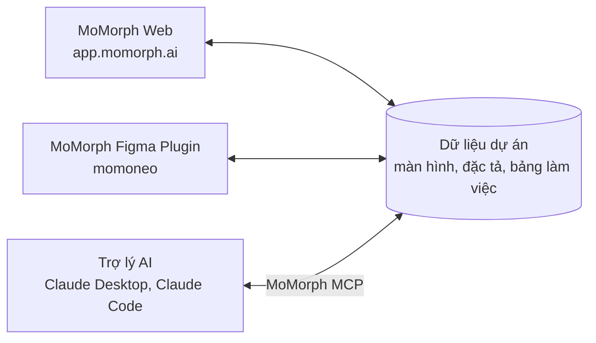

## Mục lục

1. [Cài đặt ban đầu](#setup)
2. [Dùng MCP và Web Canvas](#mcp-canvas)
3. [Màn hình và đặc tả màn hình trên Figma Plugin](#plugin)
4. [Màn hình và đặc tả màn hình trên Web](#web-screens)
5. [Đường dẫn](#links)

---

## 1. Cài đặt ban đầu {#setup}

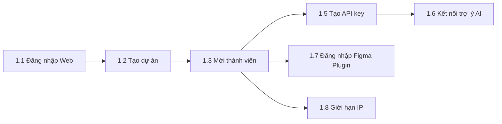

Bước 1.1 đến 1.3 là bắt buộc. Bước 1.4 đến 1.8 chỉ làm khi cần.

### 1.1 Đăng nhập Web {#login-web}

1. Mở [app.momorph.ai](https://app.momorph.ai).
2. Bấm **"Đăng nhập bằng Google"** hoặc **"Đăng nhập bằng GitHub"**.

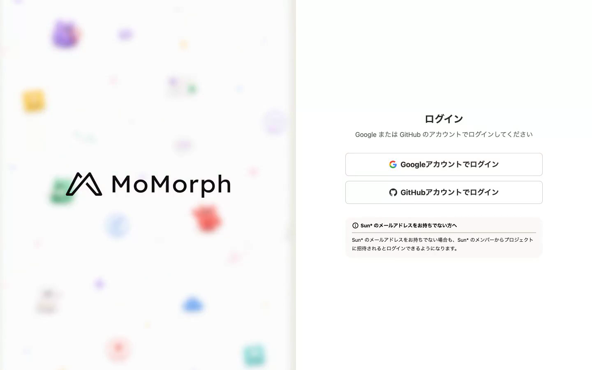{ width="720" }

3. Lần đăng nhập đầu tiên, hướng dẫn sử dụng 5 bước hiện ra. Mở lại bằng nút **"?"** (**"Xem hướng dẫn sử dụng"**).

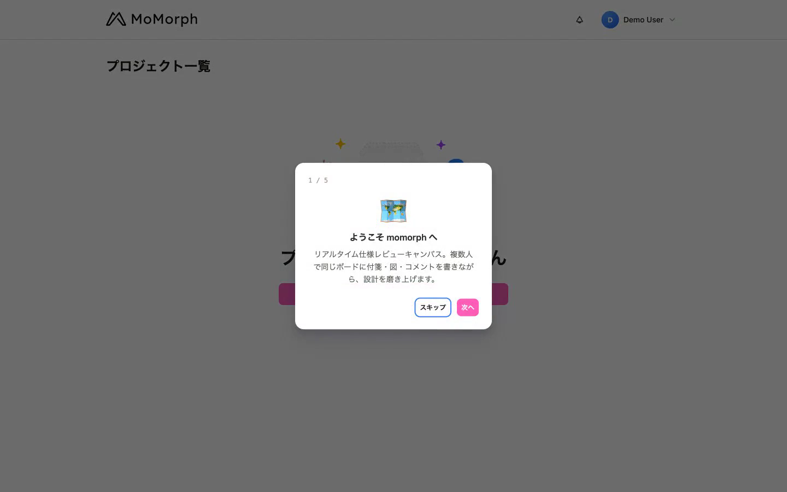{ width="720" }

### 1.2 Tạo dự án {#create-project}

Dự án là đơn vị quản lý chung màn hình, đặc tả và bảng làm việc.

1. Ở **"Danh sách project"**, bấm **"＋ Tạo project mới"**.
2. Nhập tên dự án, bấm **"Tạo"**.
3. Dự án mới hiện thành thẻ trong danh sách. Bấm vào thẻ để mở dự án.

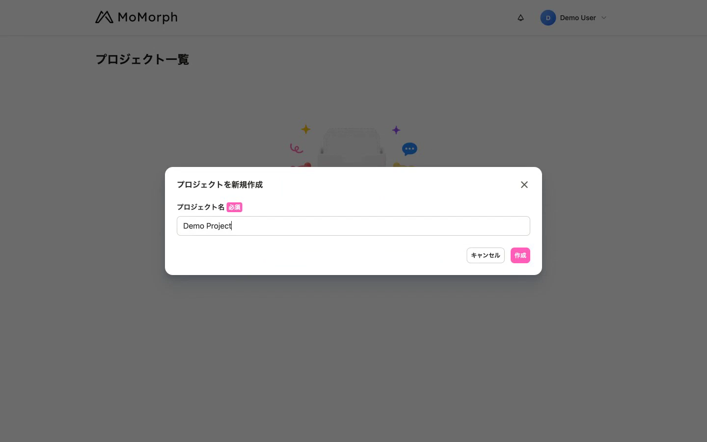{ width="720" }

!!! note "Điều kiện"
    Chỉ tài khoản email `@sun-asterisk.com` tạo được dự án. Người dùng khác chỉ vào được dự án mà họ được mời.

### 1.3 Mời thành viên {#invite-members}

Mở dự án, bấm biểu tượng bánh răng ở góc phải trên để vào **"Cài đặt dự án"**.

1. Mở mục **"Quản lý thành viên"**.
2. Nhập địa chỉ email, chọn **"Vai trò"**, rồi bấm **"Mời"**.

    | Vai trò | Quyền |
    |---|---|
    | Quản trị viên | Quản lý dự án và thành viên |
    | Thành viên | Xem và sửa nội dung |
    | Người xem | Chỉ xem |

3. Người được mời hiện trạng thái **"(Chờ duyệt)"** cho đến lần đăng nhập đầu tiên.

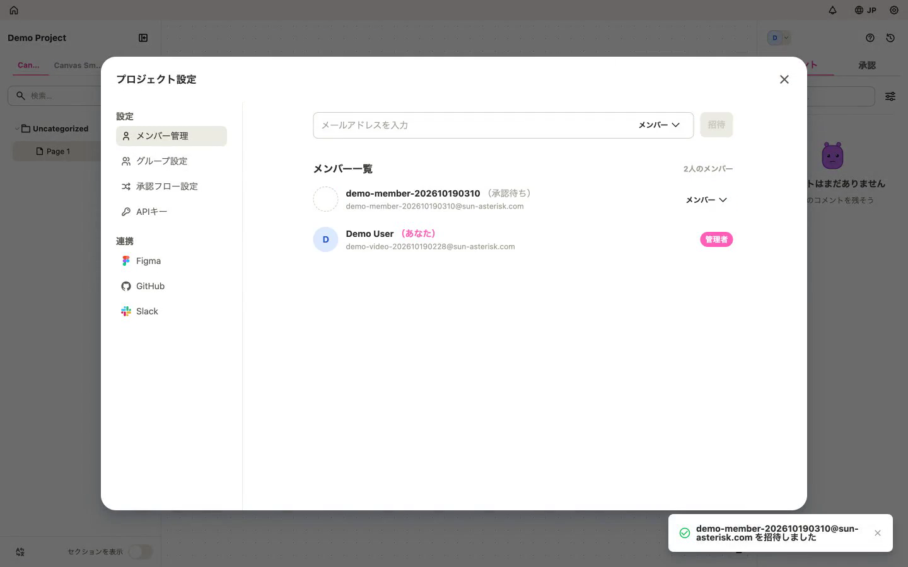{ width="720" }

### 1.4 Liên kết file Figma (tuỳ chọn) {#link-figma}

Liên kết này cho MoMorph nhận dữ liệu màn hình từ file Figma.

1. Ở mục **"Figma"** trong **"Cài đặt dự án"**, bấm **"＋ Thêm"**.
2. Nhập **"Tên"** và **"URL Figma file"**, rồi bấm **"Thêm"**.

Mỗi dự án liên kết tối đa **3 file**.

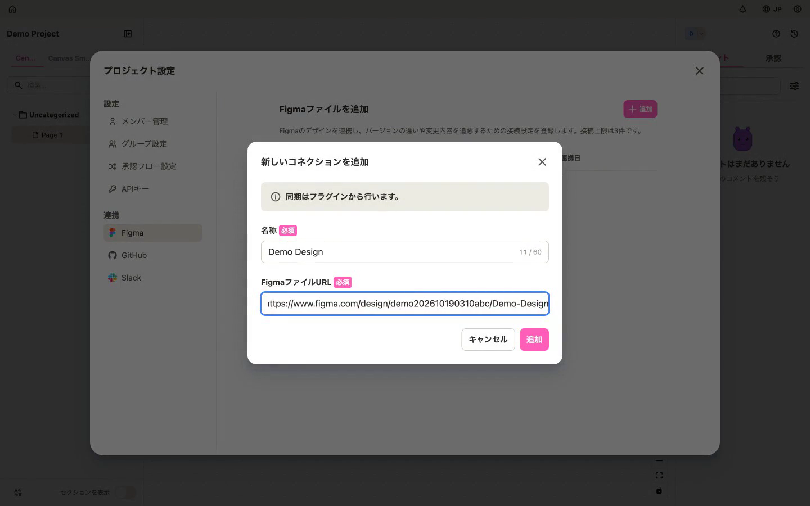{ width="720" }

### 1.5 Tạo API key {#api-key}

API key cho phép trợ lý AI đọc và ghi dữ liệu bảng làm việc và đặc tả của dự án.

1. Mở mục **"API Key"** trong **"Cài đặt dự án"**, bấm **"＋ Phát hành"**.
2. Nhập **"Tên key"**, chọn **"Hạn sử dụng"** và **"Quyền"**:
    - **"Chỉ đọc"**: trợ lý AI chỉ đọc dữ liệu.
    - **"Đọc và chỉnh sửa"**: trợ lý AI đọc và ghi dữ liệu. Muốn trợ lý AI ghi kết quả lên bảng làm việc thì phải chọn quyền này.
3. Bấm **"Phát hành"** rồi sao chép key ngay. Key chỉ hiện **một lần**.

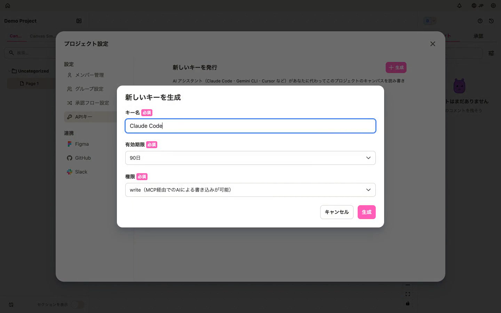{ width="720" }

!!! warning "Lưu ý"
    Giữ API key như mật khẩu. Không dán key vào tin nhắn, phiếu công việc hoặc kho mã nguồn.

### 1.6 Kết nối trợ lý AI qua MCP (tuỳ chọn) {#connect-ai}

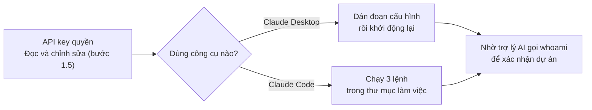

Trên Web, bấm **"Xem lại hướng dẫn kết nối AI"** để mở màn hình **"Kết nối trợ lý AI"**.

=== "Claude Desktop"

    Cần Node.js 20 trở lên.

    1. Ở màn hình **"Kết nối trợ lý AI"**, chọn thẻ **Claude Desktop** và sao chép đoạn cấu hình.
    2. Trong Claude Desktop, mở **Settings** > **Developer** > **Edit Config**, rồi dán đoạn cấu hình.
    3. Thay `YOUR_KEY` bằng API key đã tạo.
    4. Khởi động lại Claude Desktop.

    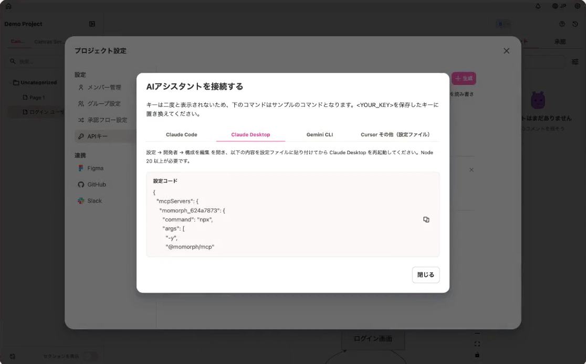{ width="720" }

    Gói cài đặt: [@momorph/mcp](https://www.npmjs.com/package/@momorph/mcp)

=== "Claude Code"

    Cần Node.js 22 trở lên. Trong thư mục làm việc, chạy 3 lệnh:

    ```bash
    npx -y @momorph/cli init      # cài kỹ năng và đăng ký MCP
    npx -y @momorph/cli connect   # dán API key khi được hỏi
    npx -y @momorph/cli doctor    # kiểm tra kết nối
    ```

    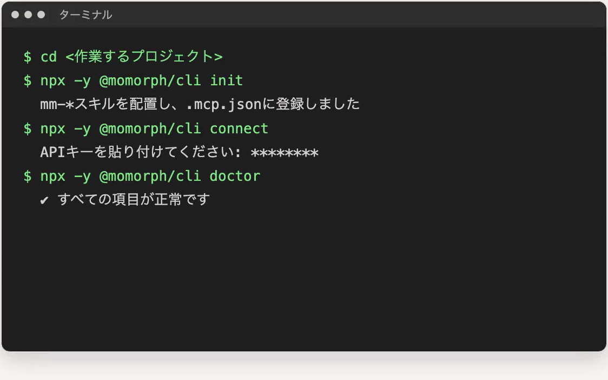{ width="720" }

    Gói cài đặt: [@momorph/cli](https://www.npmjs.com/package/@momorph/cli)

!!! note "Lưu ý"
    Khi dự án bật **"Áp dụng cả cho API key (CLI, MCP)"**, máy kết nối từ địa chỉ IP không được phép sẽ nhận lỗi `403`. Xem [1.8](#ip-restriction).

### 1.7 Đăng nhập Figma Plugin (tuỳ chọn) {#login-plugin}

Plugin của MoMorph V2 có tên **momoneo**.

- Người dùng Sun*: cài từ [Figma Community](https://www.figma.com/community/plugin/1671823699581407862/momoneo).
- Người dùng khác: liên hệ nhóm MoMorph để nhận file cài đặt.
- Chỉ người có **quyền sửa** file Figma dùng được plugin. Đây là giới hạn của Figma.

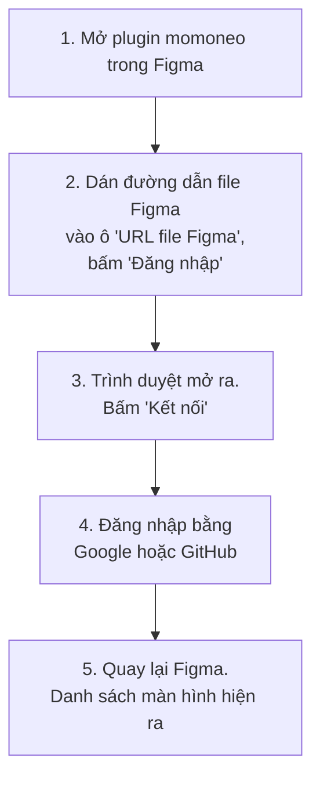

| 1. Dán đường dẫn file Figma | 2. Bấm "Kết nối" | 3. Đăng nhập | 4. Danh sách màn hình |
|---|---|---|---|
| 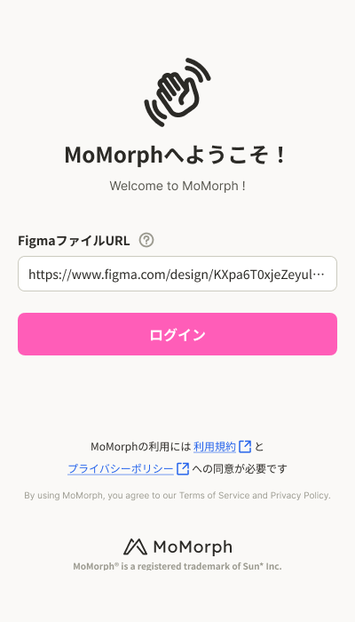 | 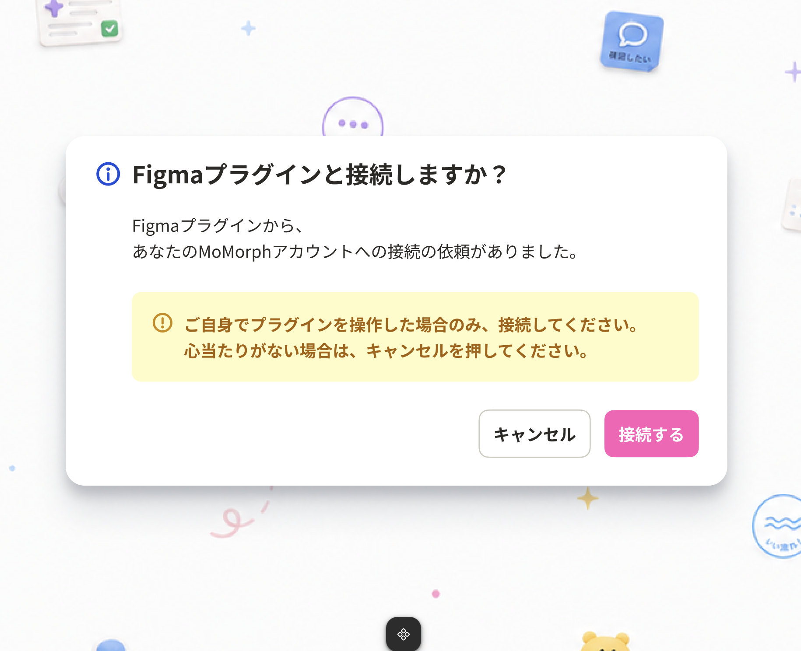 | 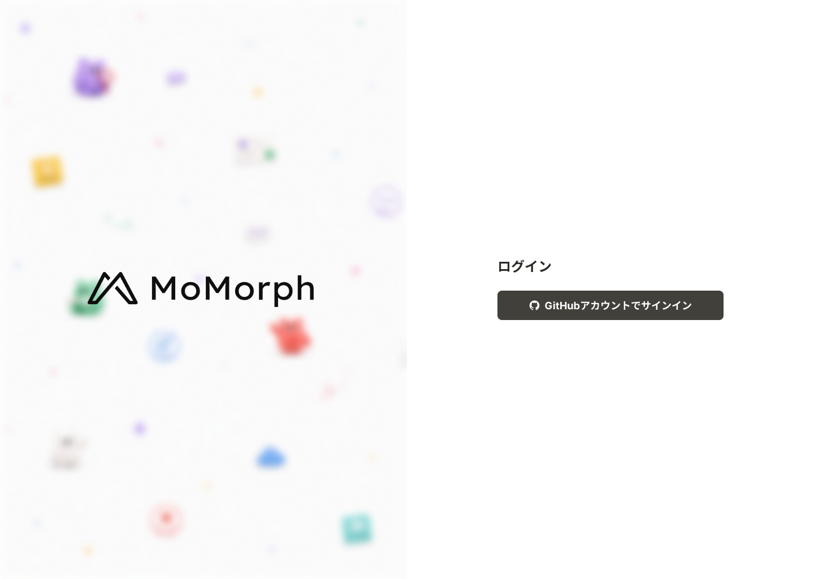 | 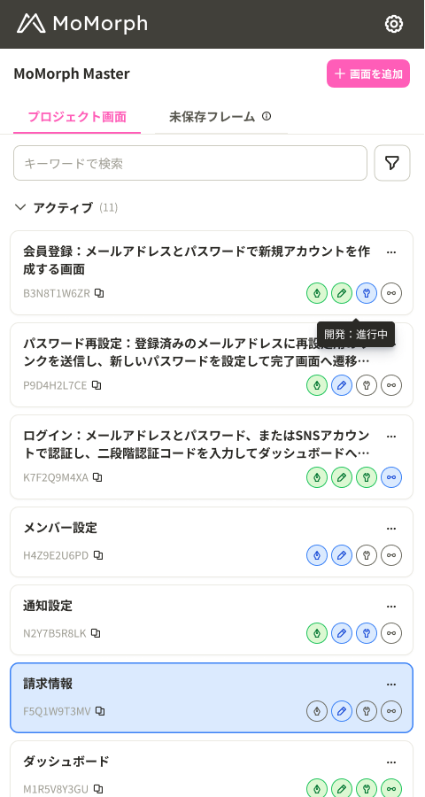 |

### 1.8 Giới hạn IP (tuỳ chọn, chỉ quản trị viên) {#ip-restriction}

Giới hạn địa chỉ IP được mở dự án. Chỉ quản trị viên của dự án cài đặt được.

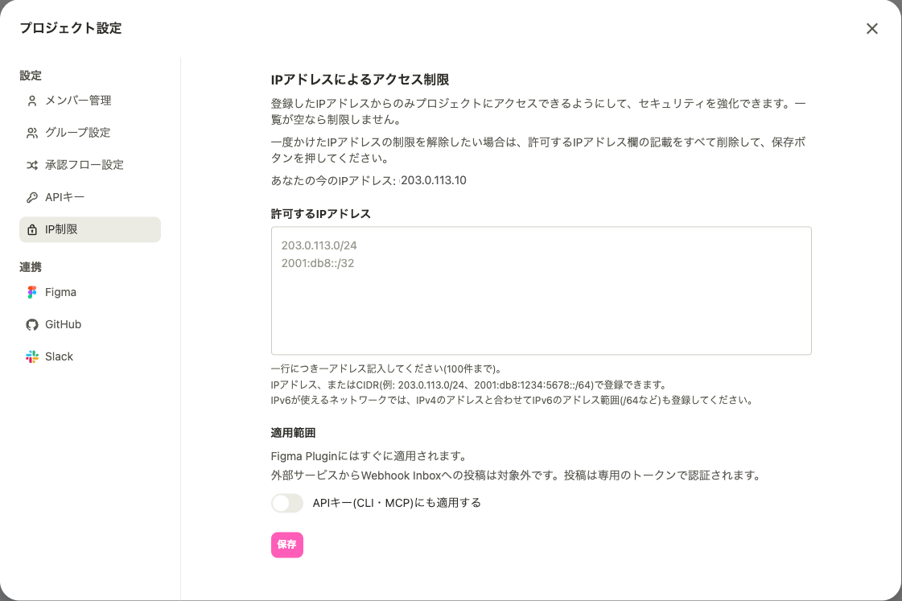{ width="720" }

1. Mở mục **"Giới hạn IP"** trong **"Cài đặt dự án"**. Xem **"Địa chỉ IP hiện tại của bạn"**.
2. Ở ô **"Địa chỉ IP được phép"**, nhập địa chỉ IP hoặc dải CIDR (ví dụ `203.0.113.0/24`), mỗi dòng một mục, tối đa **100 mục**. Mạng có IPv6 phải đăng ký thêm dải IPv6, ví dụ `/64`.
3. Bật **"Áp dụng cả cho API key (CLI, MCP)"** để áp cùng giới hạn cho CLI và MCP.
4. Bấm **"Lưu"**.

| Trường hợp | Kết quả |
|---|---|
| Danh sách không chứa địa chỉ IP hiện tại của bạn | Không lưu được |
| Danh sách rỗng | Không giới hạn. Xoá hết danh sách rồi lưu để bỏ giới hạn |
| Truy cập từ địa chỉ IP không được phép | Hiện màn hình **"Không thể mở dự án từ đây"** |
| Figma Plugin | Áp dụng ngay sau khi lưu |
| Dịch vụ bên ngoài gửi vào Webhook Inbox | Không áp dụng |

---

## 2. Dùng MCP và Web Canvas {#mcp-canvas}

### 2.1 Nhờ trợ lý AI làm việc {#ask-ai}

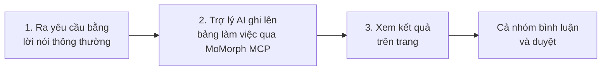

1. Ra yêu cầu cho trợ lý AI, ví dụ: "Thêm luồng người dùng cho chức năng đăng nhập".
2. Trợ lý AI ghi kết quả thẳng lên bảng làm việc của MoMorph.
3. Kết quả hiện trên trang được chỉ định. Cả nhóm xem và bình luận được.


### 2.2 Kỹ năng cho trợ lý AI {#skills}

momorph CLI cài 6 kỹ năng vào Claude Code. Kỹ năng phù hợp với yêu cầu được nạp tự động. Có thể gọi trực tiếp bằng lệnh, ví dụ `/mm:help`.

| Kỹ năng | Lệnh | Vai trò | Ví dụ yêu cầu |
|---|---|---|---|
| `mm-help` | `/mm:help` | Cài đặt ban đầu, chọn kỹ năng phù hợp | "Cài đặt momorph giúp tôi" |
| `mm-draft-graph` | `/mm:draft-graph` | Soạn nháp đặc tả, sơ đồ tuần tự, kiểm thử cùng lúc | "Tạo sơ đồ đặc tả" |
| `mm-apply-feedback` | `/mm:apply-feedback` | Đọc bình luận và tem duyệt, cập nhật đặc tả | "Cập nhật đặc tả theo bình luận" |
| `mm-tidy-board` | `/mm:tidy-board` | Sắp xếp vị trí, căn hàng, chia vùng trên bảng | "Sắp xếp lại bố cục" |
| `mm-add-mockup` | `/mm:add-mockup` | Tạo bản nháp giao diện từ đặc tả, chờ duyệt | "Tạo bản nháp giao diện từ đặc tả này" |
| `mm-build-figma` | `/mm:build-figma` | Tạo thiết kế Figma từ bản nháp đã duyệt | "Tạo bản Figma" |

`mm-add-mockup` và `mm-build-figma` cần thêm Figma MCP server.

### 2.3 Web Canvas {#canvas}

Web Canvas là bảng làm việc để cả nhóm rà soát đặc tả theo thời gian thực.

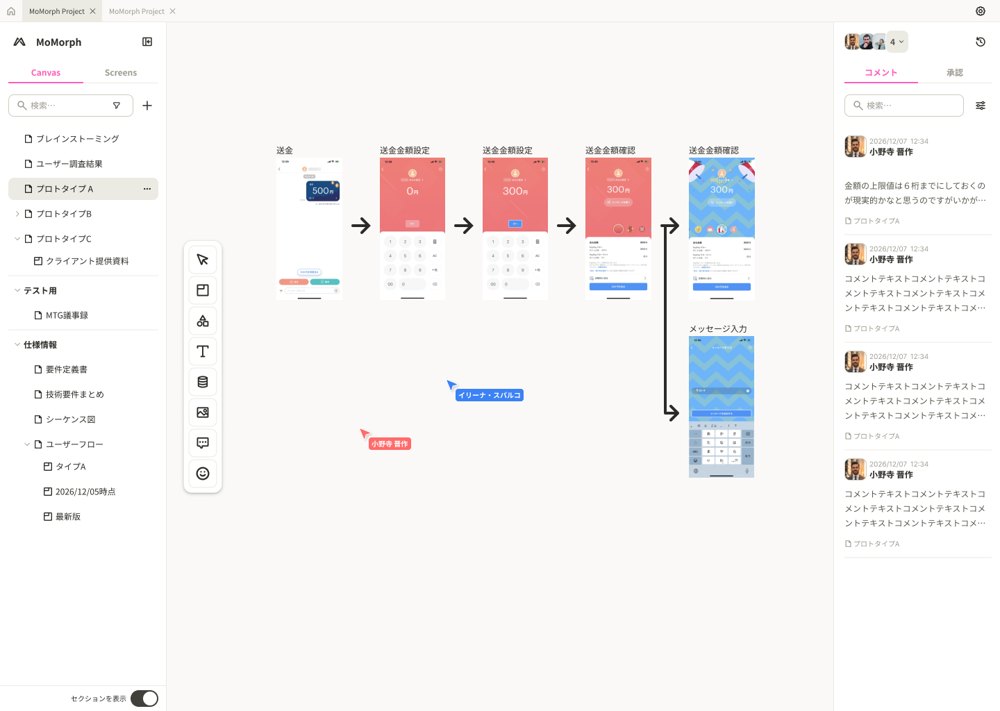

| Vùng | Chức năng |
|---|---|
| Bên trái | Chuyển trang. Phân loại trang theo danh mục |
| Ở giữa | Đặt ghi chú, hình, sơ đồ Mermaid, ảnh để sắp xếp đặc tả |
| Bên phải | Nhiều người xem và sửa cùng một trang cùng lúc |
| Từng phần tử | Chọn phần tử để bình luận, nhắc tên bằng @ để yêu cầu duyệt |

---

## 3. Màn hình và đặc tả màn hình trên Figma Plugin {#plugin}

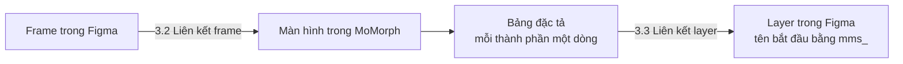

### 3.1 Màn hình chính của plugin {#plugin-overview}

| Danh sách màn hình | Chi tiết màn hình và thẻ Specs |
|---|---|
| { width="260" } | 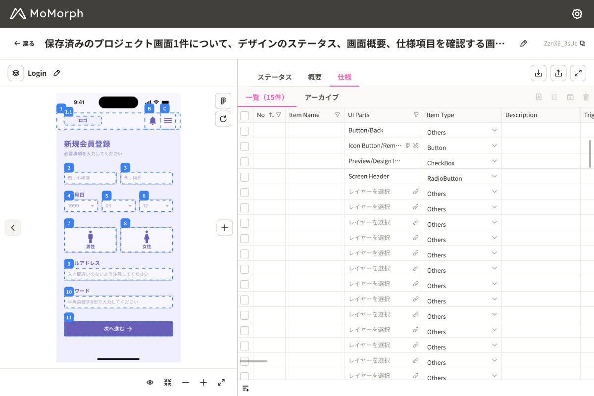 |

- **Danh sách màn hình**: trạng thái tiến độ của từng màn hình.
- **Xem trước**: đánh số từng mục trên thiết kế.
- **Bảng đặc tả** (thẻ **"Specs"**): mỗi thành phần của màn hình viết trên một dòng.
- Đặc tả viết trên plugin lưu vào cùng dữ liệu dự án, nên MoMorph Web cũng thấy.

### 3.2 Liên kết frame Figma với màn hình {#link-frame}

Mỗi màn hình liên kết được từ 1 đến **10 frame**.

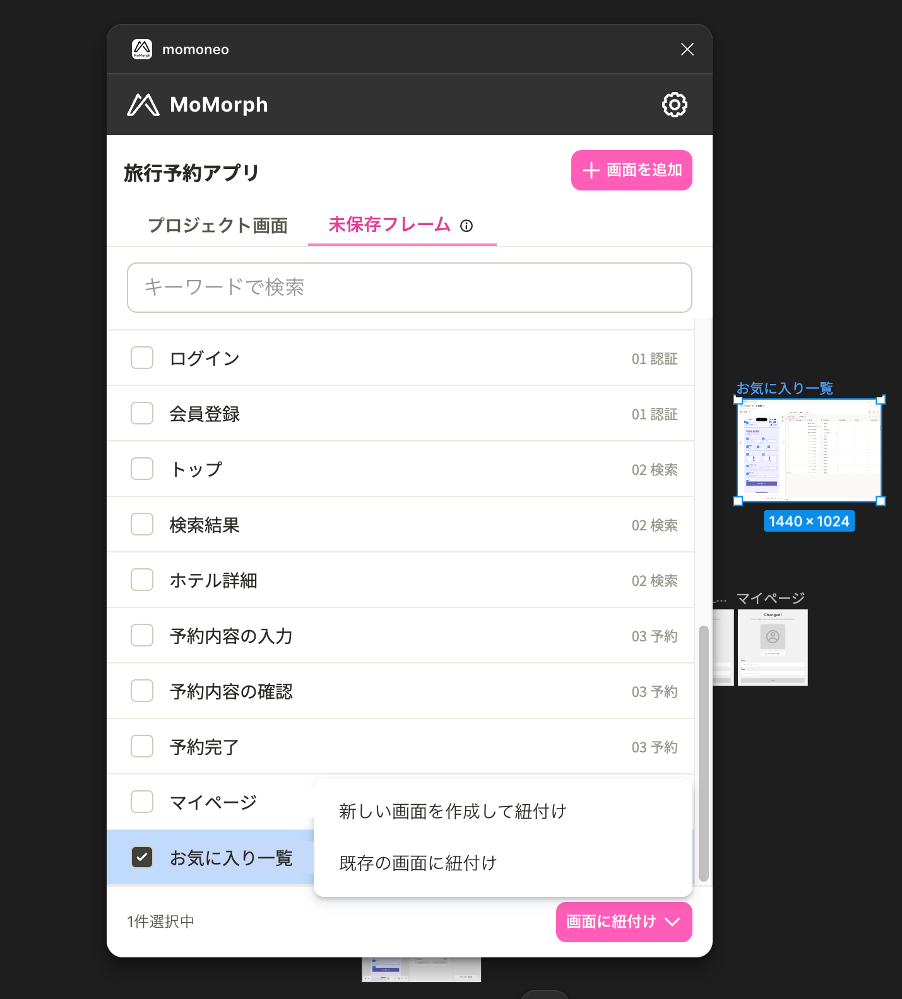{ width="560" }

1. Ở thẻ **"Frame chưa lưu"**, đánh dấu frame cần liên kết. Frame đó cũng được chọn trên Figma.
2. Bấm **"Link vào màn"**, chọn một trong hai:
    - **"Tạo màn mới rồi link"**.
    - **"Link vào màn có sẵn"**: chỉ chọn được khi đánh dấu đúng 1 frame.

### 3.3 Liên kết một dòng đặc tả với layer Figma {#link-layer}

1. Ở thẻ **"Specs"**, trên dòng cần liên kết, bấm **"Chọn layer"** ở cột **UI Parts**.
2. Trong **15 giây**, chọn một layer bên trong frame trên Figma. Không chọn được chính frame.
3. Liên kết xong, tên layer có thêm tiền tố `mms_` và phần xem trước hiện số của mục đó.

---

## 4. Màn hình và đặc tả màn hình trên Web {#web-screens}

### 4.1 Thẻ Screens {#screens}


| Vùng | Chức năng |
|---|---|
| Bên trái | Danh sách màn hình và trạng thái tiến độ |
| Ở giữa | Xem trước thiết kế, đánh số từng mục |
| Bên phải | Bảng đặc tả, mỗi thành phần một dòng |

### 4.2 Xuất và nhập file CSV {#csv}

Hai nút **"Export CSV"** và **"Import CSV"** nằm ở góc phải trên thẻ **"Specs"**.

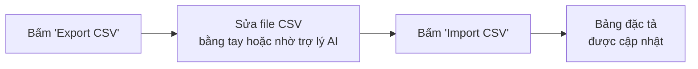

| Thao tác | Vai trò được dùng |
|---|---|
| Export CSV | Mọi vai trò |
| Import CSV | Quản trị viên và Thành viên. Người xem thấy nút bị khoá |

File nhập phải ở định dạng `.csv`, dưới 5MB, tối đa 500 dòng.

---

## 5. Đường dẫn {#links}

| Dịch vụ | Đường dẫn |
|---|---|
| MoMorph Web | [app.momorph.ai](https://app.momorph.ai) |
| MoMorph Figma Plugin momoneo | [Figma Community](https://www.figma.com/community/plugin/1671823699581407862/momoneo) (người dùng Sun*). Người dùng khác liên hệ nhóm MoMorph |
| momorph CLI (Claude Code) | [@momorph/cli](https://www.npmjs.com/package/@momorph/cli) |
| momorph MCP (Claude Desktop) | [@momorph/mcp](https://www.npmjs.com/package/@momorph/mcp) |
| Hỗ trợ | Gửi qua biểu mẫu trong kênh Slack `#con_momorph-support_all` |
