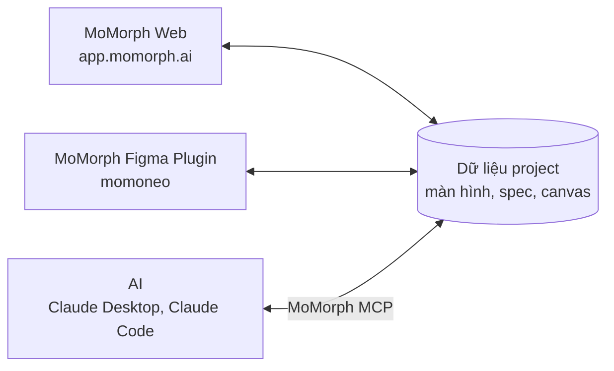
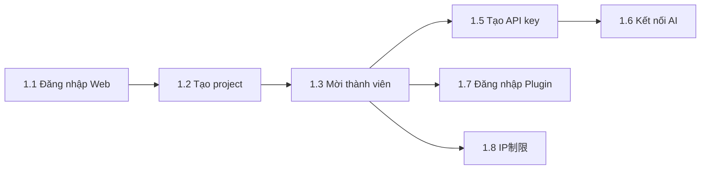
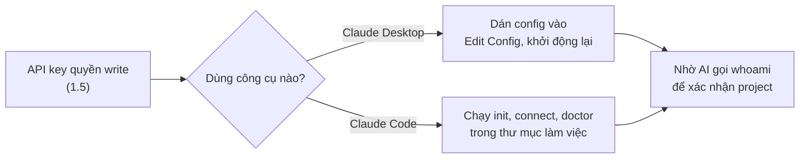
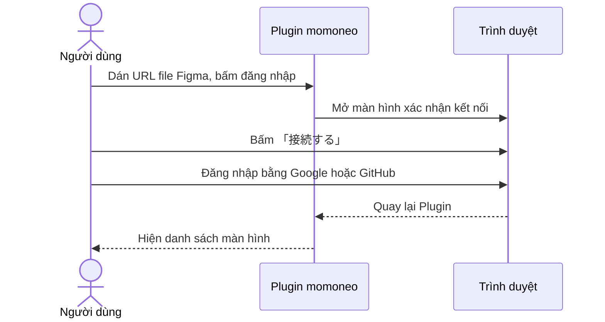
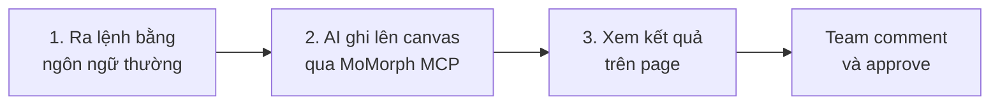
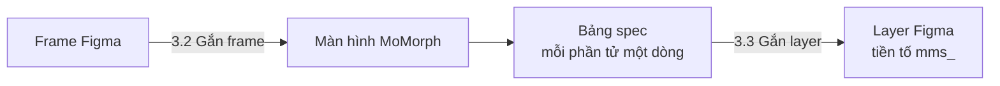
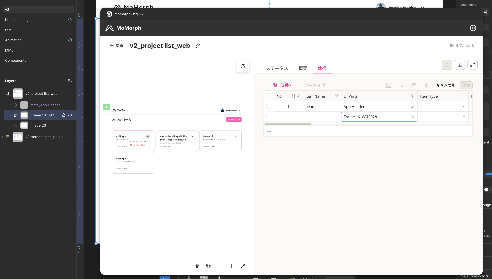
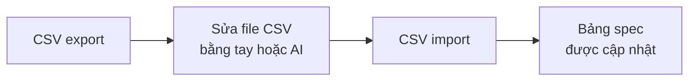

# Hướng dẫn sử dụng MoMorph V2

MoMorph V2 quản lý design Figma và spec màn hình ở một chỗ. MoMorph Web, MoMorph Figma Plugin và AI dùng chung dữ liệu của một project, nên nội dung viết ở đâu cũng xem được ngay ở nơi khác.



## Mục lục

1. [Cài đặt ban đầu](#setup)
2. [Dùng MCP và Web Canvas](#mcp-canvas)
3. [Màn hình và spec màn hình trên Figma Plugin](#plugin)
4. [Màn hình và spec màn hình trên Web](#web-screens)
5. [Link](#links)

---

## 1. Cài đặt ban đầu {#setup}



Bước 1.1 đến 1.3 là bắt buộc. Bước 1.4 đến 1.8 chỉ làm khi cần.

### 1.1 Đăng nhập Web {#login-web}

1. Mở [app.momorph.ai](https://app.momorph.ai).
2. Đăng nhập bằng **Google** hoặc **GitHub**.

{ width="720" }

3. Lần đăng nhập đầu tiên, guide 5 bước hiện ra. Mở lại guide bằng nút **「?」**.

{ width="720" }

### 1.2 Tạo project {#create-project}

Project là đơn vị quản lý chung màn hình, spec và canvas.

1. Ở trang Home, bấm nút tạo project mới.
2. Nhập tên project, bấm **Tạo**.
3. Project mới hiện thành card trong danh sách. Bấm card để mở project.

{ width="720" }

!!! note "Điều kiện"
    Chỉ tài khoản email `@sun-asterisk.com` tạo được project. Người dùng khác chỉ vào được project mà họ được mời.

### 1.3 Mời thành viên {#invite-members}

Mở project, bấm biểu tượng bánh răng ở góc phải trên để vào **Cài đặt project**.

1. Mở tab **Quản lý thành viên**.
2. Nhập email và chọn role, rồi gửi lời mời.
3. Người được mời hiện trạng thái chờ duyệt cho đến lần đăng nhập đầu tiên.

{ width="720" }

### 1.4 Liên kết file Figma (tuỳ chọn) {#link-figma}

Liên kết này cho MoMorph nhận dữ liệu màn hình từ file Figma.

- Ở tab **Figma** trong Cài đặt project, dán URL file Figma.
- Mỗi project liên kết tối đa **3 file**.

{ width="720" }

### 1.5 Tạo API key {#api-key}

API key cho phép AI đọc và ghi dữ liệu canvas và spec của project.

1. Mở tab **API key** trong Cài đặt project.
2. Nhập tên key, chọn thời hạn và quyền:
    - `read`: chỉ đọc.
    - `write`: đọc và ghi. AI phải có quyền `write` để ghi kết quả lên canvas.
3. Sao chép key ngay. Key chỉ hiện **một lần**.

{ width="720" }

!!! warning
    Giữ API key như mật khẩu. Không dán key vào chat, ticket hoặc repo.

### 1.6 Kết nối AI qua MCP (tuỳ chọn) {#connect-ai}



=== "Claude Desktop"

    Yêu cầu Node.js 20 trở lên.

    1. Trên Web, mở màn hình hướng dẫn kết nối AI, chọn tab **Claude Desktop** và sao chép đoạn config.
    2. Trong Claude Desktop, mở **Settings** > **Developer** > **Edit Config**, rồi dán đoạn config.
    3. Thay `YOUR_KEY` bằng API key đã tạo.
    4. Khởi động lại Claude Desktop.

    { width="720" }

    Package: [@momorph/mcp](https://www.npmjs.com/package/@momorph/mcp)

=== "Claude Code"

    Yêu cầu Node.js 22 trở lên. Trong thư mục làm việc, chạy 3 lệnh:

    ```bash
    npx -y @momorph/cli init      # cài skill và đăng ký MCP
    npx -y @momorph/cli connect   # dán API key khi được hỏi
    npx -y @momorph/cli doctor    # kiểm tra kết nối
    ```

    { width="720" }

    Package: [@momorph/cli](https://www.npmjs.com/package/@momorph/cli)

!!! note
    Khi project bật IP制限 cho API key, máy kết nối từ IP không được phép sẽ nhận lỗi `403`. Xem [1.8](#ip-restriction).

### 1.7 Đăng nhập Figma Plugin (tuỳ chọn) {#login-plugin}

Plugin MoMorph V2 có tên **momoneo**.

- Người dùng Sun*: cài từ [Figma Community](https://www.figma.com/community/plugin/1671823699581407862/momoneo).
- Người dùng khác: liên hệ team MoMorph để nhận file cài đặt.
- Chỉ người có **quyền edit** file Figma dùng được Plugin. Đây là giới hạn của Figma.



| 1. Dán URL file Figma | 2. Xác nhận kết nối | 3. Đăng nhập | 4. Danh sách màn hình |
|---|---|---|---|
|  |  |  |  |

### 1.8 IP制限 (tuỳ chọn, chỉ admin project) {#ip-restriction}

IP制限 giới hạn địa chỉ IP được mở project. Chỉ admin project cài đặt được.

{ width="720" }

1. Xem **IP hiện tại** của bạn hiện trên màn hình.
2. Nhập IP hoặc CIDR được phép (ví dụ `203.0.113.0/24`), mỗi dòng một mục, tối đa **100 mục**. Mạng có IPv6 phải đăng ký thêm dải IPv6, ví dụ `/64`.
3. Bật switch để áp cùng giới hạn cho API key dùng ở CLI và MCP.

| Trường hợp | Kết quả |
|---|---|
| Danh sách không chứa IP hiện tại của bạn | Không lưu được |
| Danh sách rỗng | Không giới hạn. Xoá hết danh sách rồi lưu để bỏ giới hạn |
| Truy cập từ IP không được phép | Hiện màn hình 「この場所からは開けません」 |
| Figma Plugin | Áp dụng ngay sau khi lưu |
| Webhook Inbox | Không áp dụng |

---

## 2. Dùng MCP và Web Canvas {#mcp-canvas}

### 2.1 Nhờ AI làm việc {#ask-ai}



1. Ra lệnh cho AI, ví dụ: 「ログイン機能のユーザーフローを追加して」.
2. AI ghi kết quả thẳng lên canvas của MoMorph.
3. Kết quả hiện trên page được chỉ định. Cả team xem và comment được.


### 2.2 Skill cho AI agent {#skills}

`momorph CLI` cài 6 skill vào Claude Code. Skill phù hợp với yêu cầu tự động được nạp. Gọi trực tiếp bằng lệnh như `/mm:help`.

| Skill | Lệnh | Vai trò | Ví dụ yêu cầu |
|---|---|---|---|
| `mm-help` | `/mm:help` | Cài đặt ban đầu, chọn skill phù hợp | 「momorphを設定して」 |
| `mm-draft-graph` | `/mm:draft-graph` | Soạn nháp spec, sequence diagram, test cùng lúc | 「仕様グラフを作って」 |
| `mm-apply-feedback` | `/mm:apply-feedback` | Đọc comment và stamp approve, cập nhật spec | 「コメントを仕様に反映して」 |
| `mm-tidy-board` | `/mm:tidy-board` | Sắp xếp vị trí, căn hàng, chia section trên board | 「レイアウトを整えて」 |
| `mm-add-mockup` | `/mm:add-mockup` | Tạo mockup nháp từ spec, chờ approve | 「この仕様からモックアップを作って」 |
| `mm-build-figma` | `/mm:build-figma` | Tạo design Figma từ bản nháp đã approve | 「Figma版を作って」 |

`mm-add-mockup` và `mm-build-figma` cần thêm Figma MCP server.

### 2.3 Web Canvas {#canvas}

Web Canvas là whiteboard để team review spec theo thời gian thực.


| Vùng | Chức năng |
|---|---|
| Bên trái | Chuyển page. Phân loại page theo category |
| Giữa | Đặt sticky note, hình, sơ đồ Mermaid, ảnh để sắp xếp spec |
| Bên phải | Nhiều người xem và sửa cùng một page cùng lúc |
| Node | Chọn node để comment, yêu cầu approve bằng @mention |

---

## 3. Màn hình và spec màn hình trên Figma Plugin {#plugin}



### 3.1 Màn hình chính của Plugin {#plugin-overview}

| Danh sách màn hình | Chi tiết màn hình và tab spec |
|---|---|
| { width="260" } |  |

- **Danh sách màn hình**: status tiến độ của từng màn hình.
- **Preview**: đánh số từng item trên design.
- **Bảng spec**: mỗi phần tử của màn hình viết trên một dòng.
- Spec viết trên Plugin lưu vào cùng dữ liệu project, nên MoMorph Web cũng thấy.

### 3.2 Gắn frame Figma vào màn hình {#link-frame}

Mỗi màn hình gắn được từ 1 đến **10 frame**.

{ width="560" }

1. Ở tab **「未保存フレーム」**, tick frame cần gắn. Frame đó cũng được chọn trên canvas Figma.
2. Bấm **「画面に紐付け」**, chọn tạo màn hình mới hoặc gắn vào màn hình có sẵn.
    - Chỉ gắn vào màn hình có sẵn được khi chọn đúng 1 frame.

### 3.3 Gắn dòng spec (UI Parts) vào layer Figma {#link-layer}



1. Ở tab spec, trên dòng cần gắn, bấm **「レイヤーを選択」** ở cột UI Parts.
2. Trong **15 giây**, chọn một layer bên trong frame trên Figma. Không chọn được chính frame.
3. Gắn xong, tên layer có tiền tố `mms_` và preview hiện số của item.

---

## 4. Màn hình và spec màn hình trên Web {#web-screens}

### 4.1 Trang Screens {#screens}


| Vùng | Chức năng |
|---|---|
| Bên trái | Danh sách màn hình và status tiến độ |
| Giữa | Preview design, đánh số từng item |
| Bên phải | Bảng spec, mỗi phần tử một dòng |

### 4.2 CSV export và import {#csv}

Hai icon nằm ở góc phải trên tab spec.



| Thao tác | Role được dùng |
|---|---|
| CSV export | Mọi role |
| CSV import | Admin và member. Viewer thấy icon bị disable |

File import phải ở định dạng `.csv`, dưới 5MB, tối đa 500 dòng.

---

## 5. Link {#links}

| Dịch vụ | Link |
|---|---|
| MoMorph Web | [app.momorph.ai](https://app.momorph.ai) |
| MoMorph Figma Plugin momoneo | [Figma Community](https://www.figma.com/community/plugin/1671823699581407862/momoneo) (người dùng Sun*). Người dùng khác liên hệ team MoMorph |
| momorph CLI (Claude Code) | [@momorph/cli](https://www.npmjs.com/package/@momorph/cli) |
| momorph MCP (Claude Desktop) | [@momorph/mcp](https://www.npmjs.com/package/@momorph/mcp) |
| Hỗ trợ | Slack `#con_momorph-support_all`, email `momorph-admin@sun-asterisk.com` |
